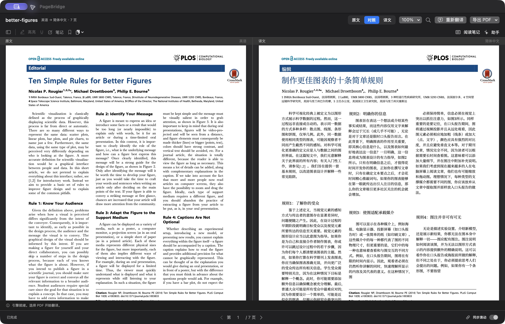
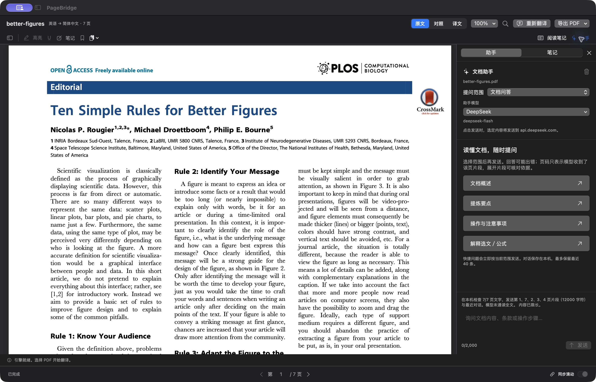
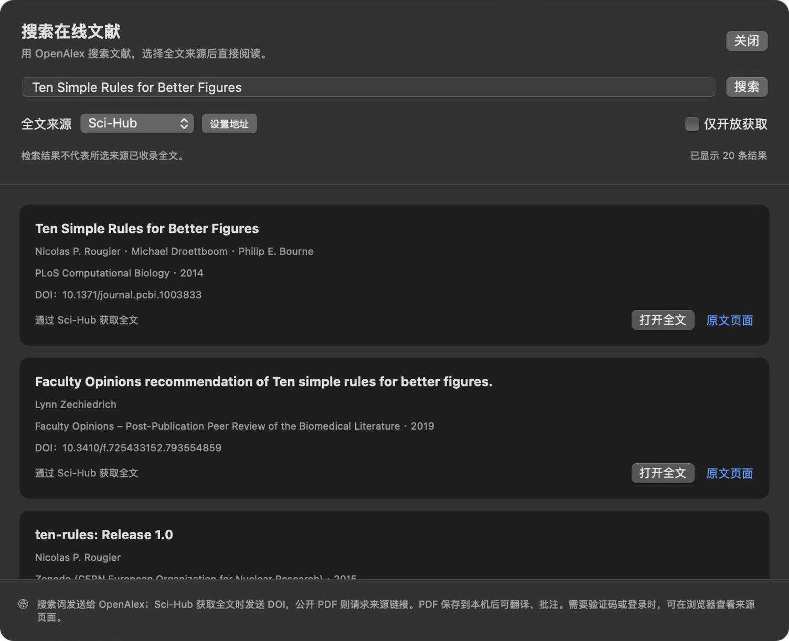

# PageBridge


**Mac 与 Windows 原生 PDF 阅读、翻译工作区。** 整理文档、保留排版翻译、原译文对照、导出译文 PDF、批注和 AI 问答，也能搜索文献并打开全文。

适用于手册、报告、教材、合同和论文等 PDF。Mac 使用 SwiftUI / AppKit / PDFKit，Windows 使用 WinUI 3。由 [MinerU](https://github.com/opendatalab/MinerU) 在本机解析并生成原页版式阅读稿，可导出为译文 PDF 和双语 PDF。翻译使用本机 Ollama 或 OpenAI 兼容 API。

[使用指南](docs/USER_GUIDE.md) · [Windows 说明](docs/WINDOWS.md) · [版本记录](CHANGELOG.md) · [Releases](https://github.com/txp666/PageBridge/releases)

## 下载

当前版本 **0.5.1 / build 15**：

| 平台 | 安装包 | 安装方式 |
|---|---|---|
| Mac（Apple Silicon） | [macOS arm64 ZIP](https://github.com/txp666/PageBridge/releases/download/v0.5.1/PageBridge-0.5.1-macOS-arm64.zip)（约 230 MB）· [SHA-256](https://github.com/txp666/PageBridge/releases/download/v0.5.1/PageBridge-0.5.1-macOS-arm64.zip.sha256) | 解压，将 `PageBridge.app` 放入“应用程序” |
| Windows x64（推荐） | [Windows 安装器](https://github.com/txp666/PageBridge/releases/download/v0.5.1/PageBridge-0.5.1-windows-x64-setup.exe)（约 200 MB）· [SHA-256](https://github.com/txp666/PageBridge/releases/download/v0.5.1/PageBridge-0.5.1-windows-x64-setup.exe.sha256) | 按向导安装，默认装到当前用户目录，无需管理员权限 |
| Windows x64（便携） | [Windows 便携 ZIP](https://github.com/txp666/PageBridge/releases/download/v0.5.1/PageBridge-0.5.1-windows-x64.zip)（约 300 MB）· [SHA-256](https://github.com/txp666/PageBridge/releases/download/v0.5.1/PageBridge-0.5.1-windows-x64.zip.sha256) | 完整解压，运行 `PageBridge.Windows.exe` |

同一 [Release 页面](https://github.com/txp666/PageBridge/releases/tag/v0.5.1)还提供项目源码和第三方对应源码。

Mac 包为 ad-hoc 签名，**没有 Developer ID 签名或 Apple 公证**；Windows 安装器和程序 **没有 Authenticode 签名**。首次打开时系统可能提示风险，请核对下载来源和 SHA-256 后再确认。

应用自带 Python 和翻译依赖，Windows 另自带 .NET 与 WinUI 运行库；**不包含语言模型**，使用 Ollama 需另行安装 Ollama 和模型。

## 电脑配置

| | Mac | Windows |
|---|---|---|
| 系统 | macOS 14 或更高 | Windows 11（未在 Windows 10 上测试） |
| 处理器 | Apple Silicon（M 系列），不支持 Intel Mac | x64；Windows 11 ARM 通过系统 x64 仿真运行，没有原生 ARM64 版本 |
| 内存 | 至少 8 GB，建议 16 GB | 至少 8 GB，建议 16 GB |
| 应用大小 | ZIP 约 60 MB，安装后约 150 MB | 安装器约 90 MB，便携 ZIP 约 130 MB，安装后约 330 MB |
| 其他 | — | 应用内网站验证使用系统 WebView2 Runtime |

- **不需要独立显卡。** MinerU 在 CPU 上运行（ONNX）。
- **磁盘：** 原页版式阅读模式首次使用会安装本地识别组件，实际约 3.2 GB（Python 环境约 1.1 GB、模型约 0.8 GB、安装缓存约 1.3 GB），**请预留约 4 GB**，另加文档和译文所需空间。
- **本机模型：** Ollama 模型的内存需求另算。例如 `qwen3.5:35b-a3b-int4` 约 20 GB，需要 32 GB 或更大内存的 Mac；只用云端 API 时不需要这部分内存。
- **网络：** 首次使用阅读模式会下载 MinerU 运行环境（Python 3.12 来自 GitHub，依赖包来自 PyPI）和 818 MB 模型（ModelScope 或 Hugging Face）。之后解析可离线进行；翻译只有使用云端 API 时才需要联网。
- **解析速度与内存（阅读模式逐页解析）：**
  - Mac 实测（Apple M5 Pro）：普通页约 4 秒，公式密集页约 23 秒；单页解析峰值内存 0.8–1.2 GB。
  - Windows 实测（Apple Silicon 上的 Windows 11 ARM 虚拟机，x64 仿真，7 GB 内存）：普通页约 16 秒，公式密集页约 33 秒；单页解析峰值内存 0.8–1.5 GB。

## 主要功能

- **文档库：** 文件夹、名称搜索、排序、收藏、最近阅读、回收站和首页预览。
- **原页版式阅读：** 整篇或指定页生成阅读稿，保持原页数、分栏、照片、色块、细边框和表格数字；正文与表格标签在原位置显示译文，行内公式随正文排列，放不下的段落点击查看全文。扫描页由 MinerU 本机识别。
- **对照与重试：** 原文／对照／译文三种视图，左右页双向连续同步滚动、统一缩放；失败段落保留原文，可单独重试。
- **导出 PDF：** 阅读稿导出为译文 PDF 或双语 PDF，译文是可选择、可搜索的文字。
- **PDF 阅读与批注：** 搜索、缩略图、目录、书签；高亮、下划线、页笔记，导出批注 PDF 和 Markdown。
- **文档助手：** 独立选择已配置的模型，按文档、当前页、选文或自由提问；回答附可核对的页码引用，可保存为笔记。
- **文献获取：** OpenAlex 搜索，Sci-Hub 或公开 PDF 全文来源，DOI 直接打开，下载校验并去重导入。

批注只加在原 PDF 上。Windows 与 Mac 的差异见 [Windows 说明](docs/WINDOWS.md)。

## 界面预览







Mac 界面截图，展示公开文献；来源与许可见[图片说明](docs/images/README.md)。

## 快速开始

1. 点击 `+` 导入 PDF，或从“搜索在线文献”按标题或 DOI 获取全文。阅读和批注不需要模型。
2. 在侧栏底部打开翻译服务设置，选择厂商和模型并填写 API Key；本机 Ollama 点击“获取模型”。
3. 点击“翻译”，选择语言和页码（例如 `1-5, 8`），生成原页版式阅读稿。
4. 切换到“对照”阅读；点击译文区域查看完整内容，失败段落可单独重试。
5. 从“导出 PDF”菜单导出译文 PDF 或双语 PDF。

应用内置五份公开示例 PDF（共 49 页，来源见[示例说明](demos/README.md)）。配置、快捷键和排错见[使用指南](docs/USER_GUIDE.md)。

## 数据、隐私与更新

| 平台 | 本机数据 | API Key | 更新 |
|---|---|---|---|
| Mac | `~/Library/Application Support/PageBridge/` | macOS 钥匙串 | Sparkle 检查并校验更新签名，由你确认安装 |
| Windows | `%LOCALAPPDATA%\PageBridge` | Windows 凭据管理器 | 手动“检查更新”，校验签名与文件后由你启动安装向导 |

PDF 解析、排版、导出、批注和助手片段提取都在本机完成。使用云端模型时，待翻译文本，或助手的问题、所选片段与近期对话，会发送给你选择的服务；OpenAlex 会收到检索词，所选全文来源会收到 DOI 或下载请求。应用不附带任何云服务额度。

机器翻译和 AI 回答可能出错，公式、数字和关键条款请对照原文。助手每次只看到有限片段，并未通读全文。

## 开发

```sh
git clone https://github.com/txp666/PageBridge.git
cd PageBridge
bash engine/setup.sh        # Mac 引擎环境
bash scripts/build-app.sh   # 生成 dist/PageBridge.app
# Windows PowerShell：./scripts/build-windows.ps1
```

见[开发指南](docs/DEVELOPMENT.md)、[架构](docs/ARCHITECTURE.md)、[Windows 构建](docs/WINDOWS.md#构建与测试)、[贡献指南](CONTRIBUTING.md)和[安全说明](SECURITY.md)。

## 许可

原创代码采用 [AGPL-3.0-only](LICENSE)。第三方组件和示例保留各自许可，见[第三方说明](THIRD_PARTY_NOTICES.md)。反馈问题请附版本、系统和脱敏复现，不要公开密钥、Cookie 或私有文档。
