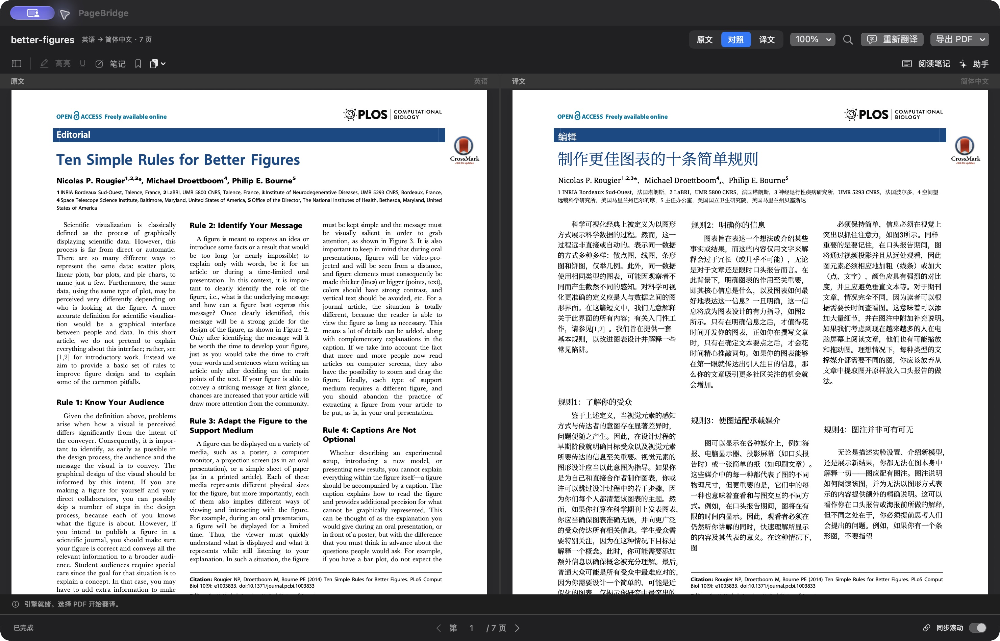
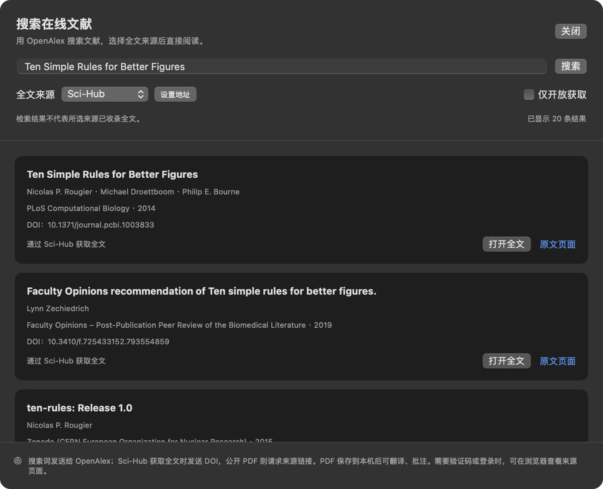
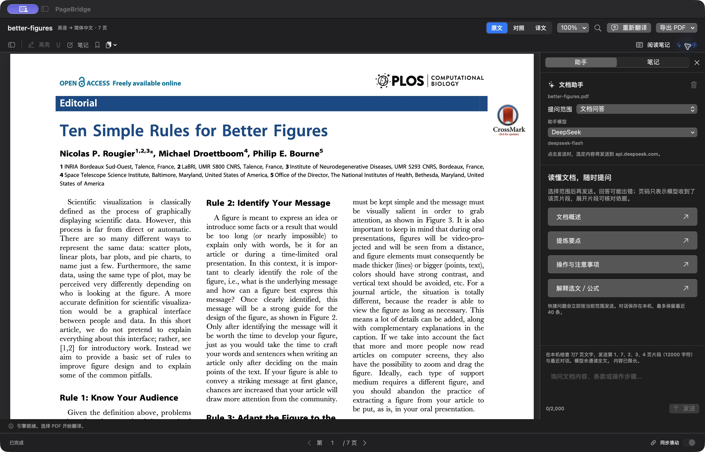

# PageBridge


**原生 Mac PDF 阅读与翻译工作区。** 整理文档、保留排版翻译、原文译文对照、添加批注，也可以搜索文献并直接打开全文。

适用于手册、报告、教材、合同和论文等带文本层的 PDF。界面使用 SwiftUI、AppKit 和 PDFKit，翻译基于 [PDFMathTranslate-next](https://github.com/PDFMathTranslate-next/PDFMathTranslate-next) / [BabelDOC](https://github.com/funstory-ai/BabelDOC)，支持本机 Ollama 和自定义 OpenAI 兼容 API。

**当前版本：0.3.0 / build 12** · [下载](https://github.com/txp666/PageBridge/releases/tag/v0.3.0) · [使用指南](docs/USER_GUIDE.md) · [版本记录](CHANGELOG.md) · [构建状态](https://github.com/txp666/PageBridge/actions)

## 核心功能

| 功能 | 说明 |
|---|---|
| 文档管理 | 文件夹、收藏、最近阅读、回收站、名称搜索、排序与首页预览 |
| PDF 翻译 | 整篇或指定页，显示真实进度，支持取消和重跑；失败保留上次成功译文 |
| 对照阅读 | 原文／对照／译文切换，缩放、文内搜索、缩略图、目录和同步滚动 |
| 批注与笔记 | 高亮、下划线、便笺、页书签，导出批注 PDF 和 Markdown 笔记 |
| 文档助手 | 文档问答、当前页、选中文字与自由提问；独立选择已配置模型，展开页码引用 |
| 文献获取 | OpenAlex 搜索，Sci-Hub／公开 PDF 全文来源，支持 DOI 直接打开与应用内站点验证 |
| 导出 | 原文、译文、交替页双语 PDF，以及批注和阅读笔记 |
| 应用更新 | 手动或经同意自动检查，签名验证，翻译期间暂缓安装 |

## 界面预览

原文与译文对照：



文献搜索与全文来源：



文档助手：



截图来自原生 0.3.0 应用，使用公开示例文献；[截图与文献归属](docs/images/README.md)。

## 下载与安装

当前安装包支持 **Apple Silicon（M 系列）Mac**，部署目标为 **macOS 14+**；暂未提供 Intel 或 Windows 版本。macOS 14 尚未完成实机验证，具体环境及验收范围见[验证记录](docs/VERIFICATION.md)。

| 下载 | 用途 |
|---|---|
| [Mac 应用 ZIP](https://github.com/txp666/PageBridge/releases/download/v0.3.0/PageBridge-0.3.0-macOS-arm64.zip) · [SHA-256](https://github.com/txp666/PageBridge/releases/download/v0.3.0/PageBridge-0.3.0-macOS-arm64.zip.sha256) | 普通用户下载安装 |
| [项目源码 ZIP](https://github.com/txp666/PageBridge/releases/download/v0.3.0/PageBridge-0.3.0-source.zip) · [SHA-256](https://github.com/txp666/PageBridge/releases/download/v0.3.0/PageBridge-0.3.0-source.zip.sha256) | 对应版本源码、测试、构建脚本和锁文件 |
| [第三方对应源码](https://github.com/txp666/PageBridge/releases/download/v0.3.0/PageBridge-0.3.0-third-party-sources.zip) · [SHA-256](https://github.com/txp666/PageBridge/releases/download/v0.3.0/PageBridge-0.3.0-third-party-sources.zip.sha256) | 随包 AGPL 组件的源码与清单 |

文件是否已公开、大小和最终哈希以 [Release 页面](https://github.com/txp666/PageBridge/releases/tag/v0.3.0)为准。

1. 退出旧版，解压 ZIP，将 `PageBridge.app` 放入“应用程序”；更新时替换旧应用文件。
2. 打开应用，在 **PageBridge → About PageBridge** 确认版本为 `0.3.0 (12)`。
3. 已有文档、译文、笔记和服务配置会继续使用，无需重新导入。

首次打开时，macOS 可能要求额外确认：当前采用 ad-hoc 签名，**尚未完成 Developer ID 签名与 Apple 公证**。请核对官方来源与 SHA-256，再自行按系统安全提示确认。OTA 更新签名不替代 Apple 公证。

应用自带 Python 和 PDF 翻译引擎，普通用户无需另外安装 Python；**不包含语言模型**。Ollama 和本地模型需单独安装，首次翻译还可能下载字体和版面分析资源。

## 快速上手

1. **打开 PDF：** 拖入文件、点击 `+`，或从“示例 PDF”选择一份公开文档。阅读、整理和批注无需配置模型。
2. **配置服务：** 打开侧栏设置或 **PageBridge → 翻译服务…**，选择厂商、模型，填写 API Key；本机 Ollama 选择已下载模型。测试连接后保存。
3. **开始翻译：** 点击“翻译”，选择语言和整篇／指定页。页码可写 `1-5, 8`；初次可先试少量页面。任务中可取消，失败不覆盖旧译文。
4. **阅读与记录：** 切换“对照”，按需开启同步滚动；选中文字添加高亮或笔记，也可打开“助手”提问。助手模型可与翻译模型不同。
5. **导出结果：** “导出 PDF”保存原文、译文或交替页双语文件；需要带批注时，从“批注与笔记”选择“导出批注 PDF”或“导出笔记”。

内置五份公开示例，共 49 页，覆盖短文、图表、公式和双栏排版；推荐先用 4 页的“可复现计算研究十条建议”熟悉流程。作者、来源和许可见[示例说明](demos/README.md)。

## 模型服务

| 方式 | 配置要点 |
|---|---|
| 在线厂商 | DeepSeek、阿里云百炼（北京）、硅基流动（中国站）、OpenAI 已预设地址；选模型并填 API Key |
| 自定义 API | 使用 OpenAI Chat Completions 兼容服务，填写 Base URL、模型 ID 和服务要求的密钥；不要填写完整 `/chat/completions` 路径 |
| 本机 Ollama | 按 [Ollama 官方指南](https://docs.ollama.com/quickstart)启动服务并下载本地模型，再点击“获取模型”；默认地址 `http://127.0.0.1:11434`，无需 API Key |

模型可从服务获取，也可手填 ID；列表可见不代表账户一定有调用权限或额度。预设之外的地域、专属网关和远程模型请使用自定义 API。API Key 保存在 macOS 钥匙串；“测试连接”只发送固定短句，保存设置不会发送文档。详细操作见[服务配置指南](docs/USER_GUIDE.md#配置翻译服务)。

## 搜索文献

**OpenAlex 负责找文献，Sci-Hub 和公开 PDF 负责获取全文。** 搜索不需要翻译 API Key，也不调用模型。

1. 点击“搜索在线文献”，输入标题、关键词、DOI 或 doi.org 链接。
2. 选择全文来源：**Sci-Hub** 按 DOI 查找，**公开 PDF** 使用 OpenAlex 返回的开放获取链接。
3. 点击“打开全文”，下载校验后进入阅读器；相同文件会复用已有记录，保留译文和笔记。

已有 DOI 可直接打开，例如 `10.1371/journal.pcbi.1003833`。遇到站点验证时，点击“在 App 中验证并继续”，自行完成验证后继续；默认 Sci-Hub 地址可在“设置地址”中修改。搜索结果不保证全文可用，单文件下载上限 100 MB；没有 DOI、链接失效或站点不可达时，可切换来源或打开原文页面。详见[文献搜索指南](docs/USER_GUIDE.md#搜索在线文献)。

## 应用更新

在 **PageBridge → 检查更新…** 手动检查，或开启“自动检查更新”。自动检查遵循首次同意流程；发现新版本后由你决定下载、安装或跳过，应用不静默下载或安装。

更新来自本项目 GitHub Releases，通过 HTTPS 获取并验证 feed 与更新包签名。翻译进行时暂缓检查与安装；失败时保留当前应用。旧的无更新菜单本地包需先手动安装此版。OTA 的实际下载、替换和重启验收范围见[验证记录](docs/VERIFICATION.md)，不以编译成功代替实机安装结果。

## 隐私与限制

- 文档副本、译文、批注和对话保存在 `~/Library/Application Support/PageBridge/`，密钥保存在钥匙串。替换应用不清空这些数据。
- 本地解析与排版在 Mac 上完成；使用云模型时，翻译文本或助手选取的片段、问题与有限近期对话发送给所选服务。
- OpenAlex 接收搜索词，Sci-Hub 接收 DOI；更新检查不发送文档、模型密钥或系统配置画像。托管方仍会收到常规网络请求元数据。
- 需要带文本层的 PDF，当前没有通用 OCR；加密文件需先解密。人名、变量、单位和原始图像文字可能保留英文。
- 助手每次只使用有限片段，文档问答最多 6 页／12,000 字符；页码引用不是结论正确的证明。重要文字、数值、公式与技术结论请对照原文核查。
- 批注绑定 PDF 版本；重新翻译后，旧坐标不会自动套到新排版。当前回收站可恢复文档，不永久删除文件或释放其占用空间。

遇到连接、超时、完整性检查、全文下载或更新问题，请先查看[常见问题](docs/USER_GUIDE.md#常见问题)。反馈时提供版本、系统、模型 ID 和脱敏复现，不要公开 API Key、Cookie 或私有文档。

## 开发与构建

原生界面位于 `macOS/Sources/PageBridge`，核心服务与存储位于 `PageBridgeCore`，`engine/` 提供翻译 worker，`scripts/` 提供打包和验证工具。需要 Apple Silicon Mac、Xcode Command Line Tools / Swift 6 和 Python 3；安装脚本管理 Python 3.12.12 及锁定依赖。

```sh
git clone https://github.com/txp666/PageBridge.git
cd PageBridge
bash engine/setup.sh
swift test --package-path macOS --disable-sandbox
engine/.venv/bin/python -B -m unittest discover -s engine/tests -v
bash scripts/build-app.sh
python3 scripts/verify-bundle.py
```

产物是 `dist/PageBridge.app`。完整测试、真实 PDF 验收与发布命令见[开发指南](docs/DEVELOPMENT.md)。版本来自 `VERSION.json`，build 必须递增；公开标签与资产不重打或覆盖。CI 执行 main／PR 测试，版本标签触发构建、签名、draft 资产核验和发布；具体结果见 [Actions](https://github.com/txp666/PageBridge/actions)。

本轮 Swift 测试共 129 项，127 通过、2 项可选测试跳过；引擎 655 项单元测试在此前打包阶段通过。公开示例已验证文献搜索、站点验证、下载和去重打开，本次未重新执行全文模型翻译。CI 发布与 OTA 实测结果按[验证记录](docs/VERIFICATION.md)区分，不把历史验证当作本次新运行。

## 文档与贡献

| 文档 | 内容 |
|---|---|
| [使用指南](docs/USER_GUIDE.md) | 服务配置、阅读、批注、助手、导出与排错 |
| [开发指南](docs/DEVELOPMENT.md) · [架构说明](docs/ARCHITECTURE.md) | 环境、测试、数据流、构建、CI 与发布 |
| [验证记录](docs/VERIFICATION.md) · [版本记录](CHANGELOG.md) | 分版本证据、已知限制与功能变化 |
| [贡献指南](CONTRIBUTING.md) · [GitHub Issues](https://github.com/txp666/PageBridge/issues) | 问题反馈与代码贡献 |
| [安全说明](SECURITY.md) | 密钥、私有数据和私密漏洞报告 |

## 许可证

PageBridge 原创程序代码采用 [GNU AGPL v3（AGPL-3.0-only）](LICENSE)。第三方依赖与示例 PDF 保留各自许可及作者归属，详见[第三方说明](THIRD_PARTY_NOTICES.md)和[示例说明](demos/README.md)。分发二进制时应同时提供匹配项目源码及所需第三方对应源码；文献不因本项目开源而改变权利归属。
